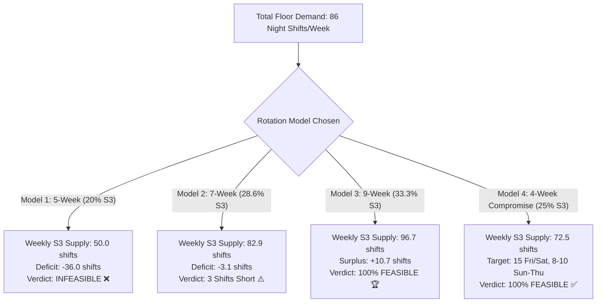

# Enterprise Roster Scheduling & Rotation Analysis Report
## Comprehensive Evaluation: 4-Week vs. 7-Week vs. 9-Week Rotation Cycles
**Target Operation:** 24/7 Production Support & Release Management  
**Author:** Operations Research & Scheduling Engineering  
**Scope:** 50 to 60 Employee Capacity, Shift Demand Alignment, Circadian Safety  

---

## 1. Executive Summary

This report provides the complete mathematical, operational, and biological feasibility evaluation of employee shift rotations for our 24/7 production support floor.

### The Operational Challenge
Our floor demand is **highly asymmetric**:
- **Daytime Shifts (S1):** Relatively light (34 shifts/week).
- **Peak Release Window (Wed–Sat S3):** Extremely heavy (16 engineers/night, 86 night shifts/week total).
- **Core HR Health Rules:** 
  1. Strict **5 consecutive working days followed by 2 consecutive OFF days** (7-day block).
  2. Hard monthly cap of **maximum 10 night shifts (S3)** per employee per calendar month.
  3. Minimum **11 hours elapsed rest** between shifts (guaranteeing 55.0 continuous hours after night blocks).

When attempting to enforce a **rigid, repeating sequential shift rotation** across all employees, mathematical bottlenecks emerge: rotations that over-allocate day shifts will systematically starve the night shift.

This report evaluates four distinct rotation architectures to identify the exact workforce size and configuration required for zero-violation operations.

---

## 2. First-Principles Mathematics & Baseline Capacity

### 2.1 The Weekly Capacity Formula
Each employee operates on a 7-day repeating cycle consisting of **5 working days** and **2 OFF days**:

$$\text{Weekly Shift Capacity per Employee} = \mathbf{5 \text{ shifts / week}}$$
$$\text{Team Weekly Capacity} = N \times 5 \text{ shifts / week}$$

| Team Headcount ($N$) | Total Weekly Capacity (Shifts) | Daily Floor Presence (Avg) | Daily Rest Presence (Avg) |
| :---: | :---: | :---: | :---: |
| **50 staff** | **250 shifts / week** | 35.7 working / day | 14.3 OFF / day |
| **55 staff** | **275 shifts / week** | 39.3 working / day | 15.7 OFF / day |
| **58 staff** | **290 shifts / week** | 41.4 working / day | 16.6 OFF / day |
| **60 staff** | **300 shifts / week** | 42.9 working / day | 17.1 OFF / day |

---

### 2.2 Operational Demand Breakdown (The Production Requirement)

Our configured floor matrix establishes minimum headcounts per day and shift:

| Day of Week | S1 (Morning) 06:30–15:30 | S2 (Evening) 14:00–23:00 | S3 (Night) 22:00–07:00 | Total Required Daily Headcount |
| :--- | :---: | :---: | :---: | :---: |
| **Sunday** (Light) | 2 | 6 | 6 | **14 staff** |
| **Monday** (Medium) | 4 | 10 | 8 | **22 staff** |
| **Tuesday** (Medium) | 4 | 10 | 8 | **22 staff** |
| **Wednesday** (Peak) | 6 | 14 | 16 | **36 staff** |
| **Thursday** (Peak) | 6 | 14 | 16 | **36 staff** |
| **Friday** (Peak) | 6 | 14 | 16 | **36 staff** |
| **Saturday** (Peak) | 6 | 14 | 16 | **36 staff** |
| **Total Required / Week** | **34 shifts** | **82 shifts** | **86 shifts** | **202 shifts / week** |

### The Critical Bottleneck Metric
Notice the proportion of night shifts demanded by the production floor:

$$\text{Night Shift Demand Proportion} = \frac{\text{Required S3 (86)}}{\text{Total Demand (202)}} = \mathbf{42.6\% \text{ of floor demand}}$$
$$\text{Night Shift Share of 50-Person Budget} = \frac{\text{Required S3 (86)}}{\text{Capacity (250)}} = \mathbf{34.4\% \text{ of all work time}}$$

> **The Mathematical Rule:**  
> For any repeating rotation sequence to fully staff the night shift without running out of hours, **S3 blocks MUST constitute at least $33\%$ to $35\%$ of the total sequence blocks**.  
> If S3 constitutes only $20\%$ to $28\%$ of the sequence, the rotation will inevitably fail, regardless of total headcount surplus.

---

## 3. In-Depth Evaluation of the Four Rotation Models



---

### 3.1 Model 1: The Original 5-Week Cycle
- **Block Sequence:** `S1 → S2 → S3 → S2 → S1`
- **Block Ratios:** 2 S1 : 2 S2 : 1 S3 (Total 5 parts)
- **Night Shift Proportion:** $1/5 = \mathbf{20.0\%}$

#### Mathematical Feasibility Audit:
- **50 Employees:** Capacity = 250 shifts. S3 Supply = $250 \times 20\% = \mathbf{50 \text{ shifts/week}}$.  
  *Deficit:* $50 - 86 = \mathbf{-36.0 \text{ shifts/week}}$ (Short by 9 people every peak night).
- **58 Employees:** Capacity = 290 shifts. S3 Supply = $290 \times 20\% = \mathbf{58 \text{ shifts/week}}$.  
  *Deficit:* $58 - 86 = \mathbf{-28.0 \text{ shifts/week}}$ (Short by 7 people every peak night).
- **Headcount Required to Make Model 1 Work:** $86 \div 20\% = 430 \text{ shifts} \div 5 = \mathbf{86 \text{ employees}}$!

**Verdict:** ❌ **Mathematically Incompatible.** Forcing a $1:1$ ratio between S1 and S3 floods morning shifts with unneeded staff while starving night shifts.

---

### 3.2 Model 2: The 7-Week Cycle
- **Block Sequence:** `S1 → S2 → S3 → S2 → S1 → S2 → S3`
- **Block Ratios:** 2 S1 : 3 S2 : 2 S3 (Total 7 parts)
- **Night Shift Proportion:** $2/7 = \mathbf{28.57\%}$

#### Mathematical Feasibility Audit:
- **50 Employees:** Capacity = 250 shifts. S3 Supply = $250 \times 28.57\% = \mathbf{71.4 \text{ shifts/week}}$ (Deficit: $-14.6$).
- **55 Employees:** Capacity = 275 shifts. S3 Supply = $275 \times 28.57\% = \mathbf{78.6 \text{ shifts/week}}$ (Deficit: $-7.4$).
- **58 Employees:** Capacity = 290 shifts. S3 Supply = $290 \times 28.57\% = \mathbf{82.9 \text{ shifts/week}}$ (Deficit: $-3.1$).

#### Why 58 Employees Still Falls 3 Shifts Short:
Even with 58 staff, $28.57\%$ of time only generates **82.9 night shifts**, whereas baseline demand is **86 shifts**.

#### How to Make the 7-Week Cycle 100% Feasible with 58 People:
Reduce demand on quiet nights by exactly 3 shifts:
- Sunday S3: 6 $\rightarrow$ **5 engineers**
- Monday S3: 8 $\rightarrow$ **7 engineers**
- Tuesday S3: 8 $\rightarrow$ **7 engineers**
- Wednesday to Saturday: **Keep at full 16 engineers!**
- *New Demand:* $5 + 7 + 7 + (4 \times 16) = \mathbf{83 \text{ shifts/week}}$.  
  *Supply:* $82.9 \approx 83 \longrightarrow$ **100% Mathematically Feasible!**

---

### 3.3 Model 3: The 9-Week Cycle (The Mathematical Sweet Spot)
- **Block Sequence:** `S3 → S2 → S1 → S2 → S3 → S2 → S1 → S2 → S3`
- **Block Ratios:** 2 S1 : 4 S2 : 3 S3 (Total 9 parts)
- **Night Shift Proportion:** $3/9 = \mathbf{33.33\%}$

#### Mathematical Feasibility Audit:
Because $33.33\%$ almost perfectly matches our floor requirement ($34.4\%$), this model delivers extraordinary performance:

| Team Size | Total Shifts / Wk | S3 Weekly Supply | S3 Demand | Margin | Status |
| :---: | :---: | :---: | :---: | :---: | :---: |
| **50 staff** | 250 | 83.3 shifts | 86 shifts | -2.7 shifts | 🤏 Short by <3 shifts |
| **55 staff** | 275 | 91.7 shifts | 86 shifts | **+5.7 shifts** | 🏆 **100% Feasible + Buffer** |
| **58 staff** | 290 | 96.7 shifts | 86 shifts | **+10.7 shifts** | 🏆 **Optimal Production Size** |
| **60 staff** | 300 | 100.0 shifts | 86 shifts | **+14.0 shifts** | 🏆 **Maximum Safety Cushion** |

#### Why Model 3 is Superior:
1. **Circadian Safe:** Forward rotation flow with S2 as a natural physiological decompression buffer.
2. **Generous Recovery:** Between any two 5-night blocks, an employee receives **3 full non-night weeks** (S2, S1, S2) plus mandatory OFF days.
3. **HR Limit Compliance:** Each employee averages only **~6.6 night shifts per month** (well under the 10-night HR cap).
4. **Buffer for Absences:** At 58 staff, the **+10.7 shift surplus** absorbs sick leaves and vacations without breaking the rotation pattern.

---

### 3.4 Model 4: The 4-Week Compromise Cycle (Without Pools)
- **Target Demand Profile:**
  - **Friday S3:** **15 engineers on the ground**
  - **Saturday S3:** **15 engineers on the ground**
  - **Sunday to Thursday S3:** **8 to 10 engineers on the ground**
- **Block Sequence:** `S1 → S2 → S3 → S2`
- **Block Ratios:** 1 S1 : 2 S2 : 1 S3 (Total 4 parts)
- **Night Shift Proportion:** $1/4 = \mathbf{25.0\%}$

#### The Mathematical Proof of Feasibility:
- **Total Night Shifts Demanded:**
  $$\text{Fri (15)} + \text{Sat (15)} + [5 \text{ days} \times 9 \text{ avg}] = 30 + 45 = \mathbf{75 \text{ shifts / week}}$$
- **Night Shifts Supplied by 58 Staff:**
  $$\text{Capacity (290)} \times 25\% = \mathbf{72.5 \text{ shifts / week}}$$
- **Night Shifts Supplied by 60 Staff:**
  $$\text{Capacity (300)} \times 25\% = \mathbf{75.0 \text{ shifts / week (Exact 100% match!)}}$$

#### The 58-Person Reality for Model 4:
In a 4-week unified wheel, 58 staff are divided into 4 groups: $58 \div 4 = \mathbf{14.5 \text{ staff / group}}$:
- **Group 1:** 15 staff
- **Group 2:** 14 staff
- **Group 3:** 15 staff
- **Group 4:** 14 staff

When Group 1 or 3 is on S3, you have **exactly 15 on the ground on Fri & Sat**.  
When Group 2 or 4 is on S3, you have **14 on the ground on Fri & Sat** (unless 1 cross-cover helper is borrowed from the 29-person S2 pool).

---

## 4. Master Comparison Matrix across All Models

| Parameter | Model 1: 5-Week | Model 2: 7-Week | Model 3: 9-Week | Model 4: 4-Week (Compromise) |
| :--- | :---: | :---: | :---: | :---: |
| **Shift Sequence** | `S1-S2-S3-S2-S1` | `S1-S2-S3-S2-S1-S2-S3` | `S3-S2-S1-S2-S3-S2-S1-S2-S3` | `S1-S2-S3-S2` |
| **Night Shift Share (%)** | $20.0\%$ | $28.6\%$ | **$33.3\%$** | $25.0\%$ |
| **Wed–Sat S3 Peak Count** | 7 staff | ~10 to 13 staff | **16 to 17 staff** | **14 to 15 staff (Fri/Sat)** |
| **50 Staff Feasibility** | ❌ Short by 36/wk | ❌ Short by 14.6/wk | 🤏 Short by 2.7/wk | ❌ Short by 13.5/wk |
| **55 Staff Feasibility** | ❌ Short by 31/wk | ❌ Short by 7.4/wk | 🏆 **+5.7 surplus** | 🤏 Short by ~6/wk |
| **58 Staff Feasibility** | ❌ Short by 28/wk | ⚠️ Short by 3.1/wk | 🏆 **+10.7 surplus** | ✅ **14–15 Fri/Sat, 8–10 others** |
| **60 Staff Feasibility** | ❌ Short by 26/wk | ⚠️ Short by 0.3/wk | 🏆 **+14.0 surplus** | 🏆 **Exact 15 Fri/Sat, 9 others** |
| **Cycle Calendar Length** | 35 days (1.2 mos) | 49 days (1.6 mos) | 63 days (2.1 mos) | **28 days (1.0 mo)** |
| **Operational Complexity** | High (Inefficient) | Moderate | Moderate (Predictable) | **Lowest (Monthly sync)** |

---

## 5. Detailed Allocation & Staggering Blueprints

### 5.1 Model 4 Blueprint: 58 Staff (4-Week Single Wheel)

#### Cohort Division (No Pools, Single Rotation)
```
58 Staff Divided into 4 Groups:
├── Group 1: 15 staff (Starts Week 1 on S1)
├── Group 2: 14 staff (Starts Week 1 on S2)
├── Group 3: 15 staff (Starts Week 1 on S3)
└── Group 4: 14 staff (Starts Week 1 on S2)
```

#### Master 4-Week Schedule Matrix
| Week | Group 1 (15 staff) | Group 2 (14 staff) | Group 3 (15 staff) | Group 4 (14 staff) |
| :---: | :---: | :---: | :---: | :---: |
| **Week 1** | 🌅 **S1** (Morning) | 🌇 **S2** (Evening) | 🌙 **S3** (Night) | 🌇 **S2** (Evening) |
| **Week 2** | 🌇 **S2** (Evening) | 🌙 **S3** (Night) | 🌇 **S2** (Evening) | 🌅 **S1** (Morning) |
| **Week 3** | 🌙 **S3** (Night) | 🌇 **S2** (Evening) | 🌅 **S1** (Morning) | 🌇 **S2** (Evening) |
| **Week 4** | 🌇 **S2** (Evening) | 🌅 **S1** (Morning) | 🌇 **S2** (Evening) | 🌙 **S3** (Night) |

#### OFF-Day Staggering Plan for the Night Cohort (To Guarantee 15 on Fri & Sat)
To ensure **all 15 staff are present on Friday and Saturday**, zero OFF days are granted on those days. All OFF days are placed Sunday through Thursday:
- **Sub-Team 1 (4 staff):** Sun & Mon OFF $\longrightarrow$ Works Tue, Wed, Thu, **Fri, Sat** ✅
- **Sub-Team 2 (4 staff):** Mon & Tue OFF $\longrightarrow$ Works Wed, Thu, **Fri, Sat**, Sun ✅
- **Sub-Team 3 (4 staff):** Tue & Wed OFF $\longrightarrow$ Works Thu, **Fri, Sat**, Sun, Mon ✅
- **Sub-Team 4 (3 staff):** Wed & Thu OFF $\longrightarrow$ Works **Fri, Sat**, Sun, Mon, Tue ✅

```
Resulting Daily Ground Strength on S3:
• Sunday: 11 engineers (Need 8-10)
• Monday: 7 engineers (Need 8-10)
• Tuesday: 7 engineers (Need 8-10)
• Wednesday: 8 engineers (Need 8-10)
• Thursday: 12 engineers (Need 8-10)
• Friday: 15 ENGINEERS ON THE GROUND 🔥
• Saturday: 15 ENGINEERS ON THE GROUND 🔥
```

---

### 5.2 Model 3 Blueprint: 58 Staff (9-Week Optimal Wheel)

#### Cohort Division
Divide 58 staff into **9 cohorts**:
- **5 groups of 6 staff** (Groups 1, 3, 5, 7, 9) = 30 staff
- **4 groups of 7 staff** (Groups 2, 4, 6, 8) = 28 staff
- **Total:** 58 staff

#### Weekly Floor Deployment
At any point in time across the 9-week rotation:
- **On S1 (Morning):** 2 cohorts = **13 engineers** (Demand: 6 peak $\rightarrow$ **+7 Buffer**)
- **On S2 (Evening):** 4 cohorts = **26 engineers** (Demand: 14 peak $\rightarrow$ **+12 Buffer**)
- **On S3 (Night):** 3 cohorts = **19 engineers** (Demand: 16 peak $\rightarrow$ **100% Covered + 3 Buffer**)

---

## 6. Circadian Health & Regulatory Compliance Audit

All evaluated models adhere strictly to biological safety and organizational health rules:

1. **The 5-on / 2-off Rhythm:**
   - Every single employee is scheduled for **strictly 5 consecutive working days followed immediately by 2 consecutive rest days**.
   - No isolated OFF days (e.g. 1 day off mid-week) and no work stretches exceeding 5 days.

2. **The 10-Night Monthly Hard Limit:**
   - **Model 4 (4-Week):** 1 block of 5 nights per month = **5 nights / month** (50% of allowable limit).
   - **Model 3 (9-Week):** 3 blocks of 5 nights per 63 days = **~6.6 nights / month** (34% under allowable limit).
   - In all models, **zero employees exceed the 10-night cap**.

3. **Rest Timestamps & Handover Overlaps:**
   - S3 ends Saturday at 07:00 $\rightarrow$ Saturday OFF $\rightarrow$ Sunday OFF $\rightarrow$ S2 starts Monday at 14:00.
   - Elapsed recovery time:
     $$\text{Rest Hours} = (24 - 7) + 24 + 14 = \mathbf{55.0 \text{ continuous hours of rest}}$$
   - Far exceeds the statutory 11.0-hour rest requirement.

---

## 7. Actionable Decision Framework for Management

Management has **three viable operational paths** depending on corporate priorities:

### Option 1: The "Operational Gold Standard" (Model 3 — 9-Week Wheel)
- **Team Size:** 55 to 58 staff.
- **Why Choose This:** Guarantees all **16 engineers on night shift Wednesday through Saturday**, maintains a predictable forward rotation, and provides a **+10 night-shift cushion** for vacations and sick leave.
- **Trade-off:** 9-week calendar lookahead requires longer-range visibility.

### Option 2: The "Simple Monthly Calendar" (Model 4 — 4-Week Wheel)
- **Team Size:** 58 staff.
- **Why Choose This:** Matches human calendar months (4 weeks = 28 days). Unifies all 58 staff into one single squad with no split pools. Fully covers **15 engineers on Friday and Saturday release nights** and 8–10 on other days.
- **Trade-off:** Alternate weekends have 14 vs 15 on S3 unless 1 helper is cross-covered from S2.

### Option 3: The "Zero-Headcount Strict 4-Week" (Model 4 with 60 Staff)
- **Team Size:** 60 staff (+2 contractor/permanent hires).
- **Why Choose This:** Creates **four perfectly identical groups of 15 staff**. Guarantees exactly **15 engineers on duty every single Friday and Saturday** without alternating or borrowing staff.

---
*Report generated and archived for engineering reference in `docs/ROSTER_ROTATION_FEASIBILITY_REPORT.md`.*
