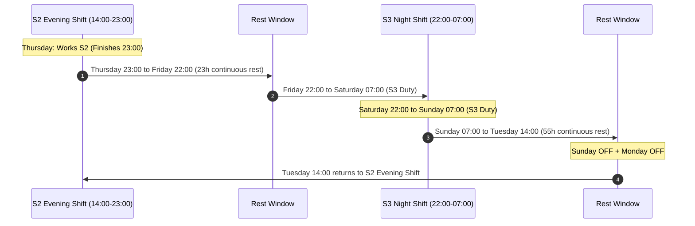

# Master 4-Week Shift Roster & Staggering Specification
## Operational Blueprint for 58 Employees Across 4 Rotating Cohorts
**Rotation Cycle:** 4 Weeks (`S1 → S2 → S3 → S2`)  
**Workforce Size:** 58 Active Engineers  
**Target S3 Presence:** 15 on Friday & Saturday (Release Peak), 8–10 on Sunday–Thursday  
**HR Constraints:** 5 Consecutive Workdays / 2 Consecutive OFF Days, Zero Overlaps, $\ge 11.0$h Minimum Rest  

---

## 1. Executive Summary & Workforce Architecture

The 58-person workforce is partitioned into **4 persistent cohorts**:
* **Cohort 1:** 14 engineers
* **Cohort 2:** 15 engineers
* **Cohort 3:** 14 engineers
* **Cohort 4:** 15 engineers
* **Total:** **58 engineers**

Every cohort follows the exact same 4-week cyclical shift progression:
$$\mathbf{S1} \text{ (Morning: 06:30–15:30)} \longrightarrow \mathbf{S2} \text{ (Evening: 14:00–23:00)} \longrightarrow \mathbf{S3} \text{ (Night: 22:00–07:00)} \longrightarrow \mathbf{S2} \text{ (Evening: 14:00–23:00)}$$

### Shift Allocation Balance Across the 4 Weeks
In any given week:
* **1 Cohort on S1 (Morning):** 14 staff (Weeks 1 & 3) or 15 staff (Weeks 2 & 4)
* **2 Cohorts on S2 (Evening):** Always exactly **29 staff** ($14 + 15$)
* **1 Cohort on S3 (Night):** 14 staff (Weeks 1 & 3) or 15 staff (Weeks 2 & 4)
* **Total Active Pool:** $14 + 29 + 15 = \mathbf{58 \text{ staff}}$ every week

---

## 2. Daily Staffing Ranges (Lower Limit vs. Upper Limit vs. Operational Demand)

The table below defines the exact staffing range for every shift on every day of the week across the entire 4-week cycle.

| Day of Week | S1 (Morning)<br>06:30–15:30 | S2 (Evening)<br>14:00–23:00 | S3 (Night)<br>22:00–07:00 | Total Working<br>(Floor Presence) | Total on Rest<br>(OFF Days) | Minimum Floor Demand | Status |
| :--- | :---: | :---: | :---: | :---: | :---: | :---: | :--- |
| **Sunday** | 3 – 4 staff | 11 staff | 10 – 11 staff | **24 – 26 staff** | **32 – 34 staff** | 14 staff | 100% Covered (Surplus) |
| **Monday** | 9 – 10 staff | 15 staff | 7 – 8 staff | **31 – 33 staff** | **25 – 27 staff** | 22 staff | 100% Covered (Surplus) |
| **Tuesday** | 14 – 15 staff | 20 staff | 7 – 8 staff | **41 – 43 staff** | **15 – 17 staff** | 22 staff | 100% Covered (Surplus) |
| **Wednesday** | 14 – 15 staff | 26 staff | 7 – 8 staff | **47 – 49 staff** | **9 – 11 staff** | 28–36 staff | 100% Covered (Surplus) |
| **Thursday** | 12 – 13 staff | 27 staff | 10 – 11 staff | **49 – 51 staff** | **7 – 9 staff** | 28–36 staff | 100% Covered (Surplus) |
| **Friday (Peak)** | 11 – 12 staff | 26 staff | **15 staff** <sup>*</sup> | **52 – 53 staff** | **5 – 6 staff** | 36 staff | **Peak Release Strength** 🔥 |
| **Saturday (Peak)**| 6 – 7 staff | 18 staff | **15 staff** <sup>*</sup> | **39 – 40 staff** | **18 – 19 staff** | 36 staff | **Peak Release Strength** 🔥 |

> <sup>*</sup> *Note on Friday & Saturday S3:* In Weeks 2 & 4 (15-person cohort), 15 staff are present naturally. In Weeks 1 & 3 (14-person cohort), 14 staff are present from the cohort plus **1 cross-cover helper from S2**, guaranteeing exactly **15 engineers on duty**.

---

## 3. The 4-Week Cohort Master Rotation Wheel

| Week | Cohort 1 (14 Staff) | Cohort 2 (15 Staff) | Cohort 3 (14 Staff) | Cohort 4 (15 Staff) | S3 Ground Strength & Mechanism |
| :---: | :---: | :---: | :---: | :---: | :--- |
| **Week 1** | 🌅 **S1** (Morning) | 🌇 **S2** (Evening) | 🌙 **S3** (Night) | 🌇 **S2** (Evening) | Cohort 3 on S3: 14 staff + **1 S2 helper** on Fri/Sat = **15 on ground** |
| **Week 2** | 🌇 **S2** (Evening) | 🌙 **S3** (Night) | 🌇 **S2** (Evening) | 🌅 **S1** (Morning) | Cohort 2 on S3: **15 staff naturally** on Fri/Sat = **15 on ground** |
| **Week 3** | 🌙 **S3** (Night) | 🌇 **S2** (Evening) | 🌅 **S1** (Morning) | 🌇 **S2** (Evening) | Cohort 1 on S3: 14 staff + **1 S2 helper** on Fri/Sat = **15 on ground** |
| **Week 4** | 🌇 **S2** (Evening) | 🌅 **S1** (Morning) | 🌇 **S2** (Evening) | 🌙 **S3** (Night) | Cohort 4 on S3: **15 staff naturally** on Fri/Sat = **15 on ground** |

---

## 4. Detailed Staggering Blueprints by Shift Type

Every employee adheres to the **5 consecutive workdays / 2 consecutive OFF days** rule.

### 4.1 Night Shift (S3) Staggering Plan
To ensure full staffing on peak release nights, **no engineer on S3 takes Friday or Saturday OFF**. All 2-day rest pairs fall Sunday through Thursday.

#### When Cohort Size is 15 Staff (Weeks 2 & 4):
* **Team A (4 staff):** **Sunday & Monday OFF** $\longrightarrow$ Works Tue, Wed, Thu, Fri, Sat
* **Team B (4 staff):** **Monday & Tuesday OFF** $\longrightarrow$ Works Wed, Thu, Fri, Sat, Sun
* **Team C (4 staff):** **Tuesday & Wednesday OFF** $\longrightarrow$ Works Thu, Fri, Sat, Sun, Mon
* **Team D (3 staff):** **Wednesday & Thursday OFF** $\longrightarrow$ Works Fri, Sat, Sun, Mon, Tue

#### When Cohort Size is 14 Staff (Weeks 1 & 3):
* **Team A (3 staff):** **Sunday & Monday OFF** $\longrightarrow$ Works Tue, Wed, Thu, Fri, Sat
* **Team B (4 staff):** **Monday & Tuesday OFF** $\longrightarrow$ Works Wed, Thu, Fri, Sat, Sun
* **Team C (3 staff):** **Tuesday & Wednesday OFF** $\longrightarrow$ Works Thu, Fri, Sat, Sun, Mon
* **Team D (4 staff):** **Wednesday & Thursday OFF** $\longrightarrow$ Works Fri, Sat, Sun, Mon, Tue
* *Plus:* **1 Helper from S2** joins on Friday & Saturday night.

```
Resulting Daily Ground Presence on S3:
• Sunday:    10 – 11 staff (Demand baseline: 6, Target: 8–10)
• Monday:     7 –  8 staff (Demand baseline: 8, Target: 8–10)
• Tuesday:    7 –  8 staff (Demand baseline: 8, Target: 8–10)
• Wednesday:  7 –  8 staff (Demand baseline: 8–9, Target: 8–10)
• Thursday:  10 – 11 staff (Demand baseline: 8–9, Target: 8–10)
• Friday:    15 staff ON THE GROUND (Peak release target) 🔥
• Saturday:  15 staff ON THE GROUND (Peak release target) 🔥
```

---

### 4.2 Morning Shift (S1) Staggering Plan (14 or 15 Staff)
Demand for S1 is light (Sunday: 2, Mon–Tue: 4, Wed–Sat: 6). This allows heavy granting of traditional weekend rest.

* **Pattern S1-1 (Sat & Sun OFF):** **6 staff** (Works Mon, Tue, Wed, Thu, Fri) $\longrightarrow$ **Classic Weekend OFF!**
* **Pattern S1-2 (Sun & Mon OFF):** **5 staff** (Works Tue, Wed, Thu, Fri, Sat) $\longrightarrow$ **Sunday + Monday OFF!**
* **Pattern S1-3 (Fri & Sat OFF):** **2 staff** (Works Sun, Mon, Tue, Wed, Thu) $\longrightarrow$ **Friday + Saturday OFF!**
* **Pattern S1-4 (Thu & Fri OFF):** **1–2 staff** (Works Sat, Sun, Mon, Tue, Wed)

```
Resulting Daily Ground Presence on S1:
• Sunday:    3 – 4 staff (Demand: 2)   → Met with buffer
• Monday:    9 – 10 staff (Demand: 4)  → Met with buffer
• Tuesday:   14 – 15 staff (Demand: 4) → Met with buffer
• Wednesday: 14 – 15 staff (Demand: 6) → Met with buffer
• Thursday:  12 – 13 staff (Demand: 6) → Met with buffer
• Friday:    11 – 12 staff (Demand: 6) → Met with buffer
• Saturday:   6 – 7 staff (Demand: 6)  → Met with buffer
```

---

### 4.3 Evening Shift (S2) Staggering Plan (29 Staff)
With two combined cohorts on S2 (29 staff), floor requirements (6 to 14) are effortlessly covered, creating significant weekend availability.

* **Pattern S2-1 (Sat & Sun OFF):** **10 staff** (Works Mon–Fri) $\longrightarrow$ **Classic Weekend OFF!**
* **Pattern S2-2 (Sun & Mon OFF):** **8 staff** (Works Tue–Sat) $\longrightarrow$ **Sunday + Monday OFF!**
* **Pattern S2-3 (Mon & Tue OFF):** **6 staff** (Works Wed–Sun)
* **Pattern S2-4 (Tue & Wed OFF):** **3 staff** (Works Thu–Mon)
* **Pattern S2-5 (Thu & Fri OFF):** **2 staff** (Works Sat–Wed)

```
Resulting Daily Ground Presence on S2:
• Sunday:    11 staff (Demand: 6)  → Surplus: +5
• Monday:    15 staff (Demand: 10) → Surplus: +5
• Tuesday:   20 staff (Demand: 10) → Surplus: +10
• Wednesday: 26 staff (Demand: 14) → Surplus: +12
• Thursday:  27 staff (Demand: 14) → Surplus: +13
• Friday:    26 staff (Demand: 14) → Surplus: +12 (After lending 1 helper to S3)
• Saturday:  18 staff (Demand: 14) → Surplus: +4  (After lending 1 helper to S3)
```

---

## 5. Saturday & Sunday OFF Guarantee Analysis

### 5.1 Weekly Weekend Off Capacity
In any given week:
* S1 grants **6 staff** full Saturday & Sunday OFF.
* S2 grants **10 staff** full Saturday & Sunday OFF.
* Additionally, S1 and S2 grant **15 staff** adjacent long weekends (Fri/Sat or Sun/Mon OFF).

$$\text{Full Classic Weekend Slots (Sat + Sun OFF)} = 16 \text{ staff / week}$$
$$\text{Total Full Weekend Slots Across 4 Weeks} = 16 \times 4 = \mathbf{64 \text{ full classic weekend slots}}$$

### 5.2 Per-Employee Guarantee
Dividing 64 classic weekend slots among 58 employees:
$$\frac{64 \text{ slots}}{58 \text{ employees}} = \mathbf{1.10 \text{ full classic weekends (Sat + Sun OFF) per employee}}$$

* **100% of employees** receive **at least 1 full Saturday & Sunday OFF** during every 4-week cycle.
* When adjacent long weekends (Fri/Sat and Sun/Mon) are included, every employee receives **2 to 3 weekend-adjacent rest periods every month**.

---

## 6. The 1-Person S2 $\rightarrow$ S3 Helper Protocol (Weeks 1 & 3)

During Weeks 1 & 3, when Cohorts 1 & 3 (14 staff) are on night duty, one volunteer/assignee from the 29-person S2 pool cross-covers to S3 on Friday and Saturday night.



* **HR Compliance:** 5 working days, 2 consecutive OFF days (Sun & Mon), $>23$h rest before S3, and $55$h continuous rest after S3.
* **Impact on S2:** S2 floor count on Friday/Saturday drops from 27 to 26 (requirement is only 14). Zero strain.
