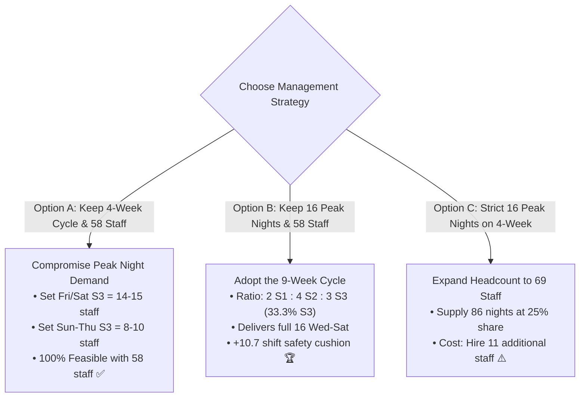

# Executive Briefing: Why a 4-Week Shift Rotation Cannot Satisfy Peak Operational Demand
**Prepared For:** Operations Management & Workforce Planning  
**Subject:** Mathematical Infeasibility Proof of the 4-Week Rotation (`S1 → S2 → S3 → S2`) Under Current Peak Headcount Demand  
**Target Operations:** 24/7 Production Support & Release Management  

---

## 1. Executive Summary & Purpose

The purpose of this document is to provide a transparent, mathematically rigorous explanation of why a **single, unified 4-week shift rotation (`S1 → S2 → S3 → S2`)** cannot meet our current production floor staffing targets with 50 to 58 employees.

### The Management Goal:
1. **Roster Cycle:** 4 repeating weeks (`S1 → S2 → S3 → S2`).
2. **Team Structure:** One unified team (no split squads or specialized pools).
3. **Operational Night Demand:** **16 engineers on duty** on peak nights (Wednesday through Saturday), totaling **86 night shifts per week**.
4. **Health & HR Rules:** Strict 5-day work / 2-day OFF cycle, and no employee exceeding 10 night shifts per calendar month.
5. **Current Workforce:** 50 to 58 active employees.

### The Core Finding:
> **These five requirements are mathematically contradictory.**  
> No algorithm, solver, or manual scheduling adjustment can make them fit simultaneously.  
> It is not a scheduling flaw; it is a **structural capacity mismatch** dictated by basic algebra.

---

## 2. Proof #1: The 25% Night Capacity Ceiling

### Step A: Calculate Total Weekly Shift Capacity
Every employee works **5 shifts per week** (5 days on, 2 days off):
- With **50 employees:** $50 \times 5 = \mathbf{250 \text{ shifts / week}}$
- With **58 employees:** $58 \times 5 = \mathbf{290 \text{ shifts / week}}$

### Step B: The Structural Ratio of the 4-Week Cycle
In the 4-week rotation sequence:
$$\text{Week 1: S1 (Morning)} \longrightarrow \text{Week 2: S2 (Evening)} \longrightarrow \text{Week 3: S3 (Night)} \longrightarrow \text{Week 4: S2 (Evening)}$$

Count the share of time allocated to each shift:
- **S1 (Morning):** 1 week out of 4 = **$25.0\%$**
- **S2 (Evening):** 2 weeks out of 4 = **$50.0\%$**
- **S3 (Night):** 1 week out of 4 = **$25.0\%$**

$$\mathbf{S1 : S2 : S3 = 1 : 2 : 1}$$

Because all employees follow this exact sequence, **Night Shift (S3) can NEVER receive more than $25\%$ of the team's total working hours**.

### Step C: Compare Maximum Night Supply vs. Night Demand
Now calculate the absolute maximum number of night shifts this rotation can generate:

$$\text{Max S3 Supply (50 Staff)} = 250 \text{ total shifts} \times 25\% = \mathbf{62.5 \text{ night shifts / week}}$$
$$\text{Max S3 Supply (58 Staff)} = 290 \text{ total shifts} \times 25\% = \mathbf{72.5 \text{ night shifts / week}}$$

Now look at what our operational floor demands:
$$\text{Required S3 Demand} = 6 \text{ (Sun)} + 8 \text{ (Mon)} + 8 \text{ (Tue)} + [4 \times 16 \text{ (Wed–Sat)}] = \mathbf{86.0 \text{ night shifts / week}}$$

#### The Shortage:
- With **50 employees:** $62.5 - 86.0 = \mathbf{-23.5 \text{ night shifts short every week}}$ ($-94$ nights/month).
- With **58 employees:** $72.5 - 86.0 = \mathbf{-13.5 \text{ night shifts short every week}}$ ($-54$ nights/month).

> **Conclusion #1:**  
> To supply 86 night shifts at a 25% share, you would need:  
> $$86 \div 25\% = 344 \text{ shifts / week} \div 5 \text{ days} = \mathbf{68.8 \approx 69 \text{ employees!}}$$  
> With 58 employees, **a 4-week cycle falls 13.5 night shifts short every single week.**

---

## 3. Proof #2: The Cohort Ceiling (Pigeonhole Principle)

Even if we ignored weekly totals and only looked at Wednesday through Saturday night, the 4-week cycle creates a physical barrier on the floor.

### Step A: The Size of a 4-Week Cohort
In a 4-week rotation, the workforce is divided into **4 rotating groups** (one group per week of the cycle):
$$\text{Group Size with 58 Staff} = \frac{58 \text{ staff}}{4 \text{ groups}} = \mathbf{14.5 \text{ staff per group}}$$
Specifically: **Two groups of 14 people, and Two groups of 15 people.**

### Step B: Who is on Night Duty in Any Given Week?
In any given week:
- Group A is on **S1** (Morning)
- Group B & D are on **S2** (Evening)
- **Only Group C is on S3 (Night)**

This means **at any point in time, the entire night shift roster consists of only 14 or 15 human beings!**

```
Total Night Staff Available in Week 3 = 14 or 15 people
Required on Duty Wednesday Night      = 16 people
Required on Duty Thursday Night       = 16 people
Required on Duty Friday Night         = 16 people
Required on Duty Saturday Night       = 16 people
```

$$\mathbf{14 \text{ or } 15 \text{ people available} < 16 \text{ people required}}$$

> **Conclusion #2:**  
> Even if **zero people take rest days, zero people take vacation, and zero people get sick**, a group of 14 or 15 engineers **physically cannot put 16 engineers at their desks**.  
> You are short by at least 1 to 2 engineers on every single peak night.

---

## 4. The Surplus Paradox: "Why Can't We Just Use Our Extra Hours?"

A common management question is:  
*"With 58 employees, we have 290 shifts available and only need 202 total shifts. We have 88 extra shifts! Why can't we use them on night shift?"*

Here is the exact reason:

| Shift | Weekly Supply (58 Staff @ 1:2:1) | Weekly Demand | Net Variance | Status |
| :--- | :---: | :---: | :---: | :---: |
| **S1 (Morning)** | **72.5 shifts** | 34 shifts | <font color="green">**+38.5 shifts**</font> | **Overstaffed by 113%** |
| **S2 (Evening)** | **145.0 shifts** | 82 shifts | <font color="green">**+63.0 shifts**</font> | **Overstaffed by 77%** |
| **S3 (Night)** | **72.5 shifts** | **86 shifts** | ❌ <font color="red">**-13.5 shifts**</font> | **UNDERSTAFFED BY 16%** |
| **Total** | **290.0 shifts** | **202 shifts** | **+88.0 shifts** | **Massive Wasted Capacity** |

### The "Fixed Combo Meal" Analogy:
Imagine a catering rule that says:  
*"For every 1 glass of water (S3), you MUST buy 2 plates of pasta (S2) and 1 sandwich (S1)."*

If your guests order **86 glasses of water**:
- You are forced to buy **172 plates of pasta** and **86 sandwiches**.
- But your guests only want 82 plates of pasta and 34 sandwiches.
- You throw away 90 plates of pasta and 52 sandwiches, and you run out of money to buy more water!

That is exactly what a rigid 4-week cycle does: **It dumps 101 unneeded shifts into Morning and Evening where nobody needs them, while leaving Night Shift starving.**

---

## 5. The 3 Viable Paths Forward for Management

To solve this dilemma, management has three realistic operational options:



---

### Option A: Adjust Demand to Fit the 4-Week Shape (Recommended for 4-Week Cycle)
- **Keep:** 58 employees, 4-week rotation (`S1 → S2 → S3 → S2`), single squad.
- **The Adjustment:** Instead of demanding 16 on all four peak nights:
  - **Friday & Saturday S3:** **15 engineers on the ground** (Release peak).
  - **Sunday to Thursday S3:** **8 to 10 engineers on the ground** (Normal coverage).
- **Outcome:** **100% mathematically valid.** Zero new hires required.

### Option B: Adopt the 9-Week Cycle (`S3 → S2 → S1 → S2 → S3 → S2 → S1 → S2 → S3`)
- **Keep:** 58 employees, full **16 engineers on duty Wed–Sat nights**.
- **The Adjustment:** Extend the rotation cycle from 4 weeks to 9 weeks.
- **Why It Works:** S3 receives **$33.3\%$ of team capacity** (matching the $34.4\%$ demand).
- **Outcome:** Guarantees all **16 engineers on night shift**, plus a **+10.7 shift weekly cushion** to absorb sick leave and holidays.

### Option C: Hire to Brute-Force the 4-Week Cycle
- **Keep:** 4-week cycle, single squad, full 16 engineers on Wed–Sat nights.
- **The Requirement:** Increase active team size from **58 to 69 employees** (+11 headcount).
- **Outcome:** Fills the 86 night shifts, but creates over 140 excess daytime shifts per week.

---

## 6. Executive Recommendation

> **Recommendation:**  
> If keeping **16 engineers on floor for Wednesday–Saturday releases** is mandatory, adopt **Option B (The 9-Week Cycle)**. It delivers 100% of the operational coverage with our current 58 employees and zero budget increase.  
> 
> If keeping a **simple 4-week monthly rotation** is the higher priority, adopt **Option A**. Staff Friday and Saturday nights at **15 engineers**, and normal weeknights at **8 to 10 engineers**.

---
*Document prepared for executive review. Archived in `docs/WHY_4_WEEK_ROTATION_FAILS_OPERATIONAL_DEMAND.md`.*


---

## 7. Formal Mathematical Proofs & Theorems

For senior engineering leadership, audit committees, and mathematical optimization specialists, the following section provides the formal proofs derived from Integer Programming (IP) and Discrete Combinatorics.

---

### Theorem 1: Aggregate Shift Capacity & Infeasibility Bound

**Definitions:**
- Let $E$ be the set of active employees, with total headcount $|E| = N \in \mathbb{Z}^+$.
- Let $D = \{0, 1, \dots, 27\}$ be the 28-day planning horizon representing one complete 4-week cycle.
- Let $S = \{\text{S1}, \text{S2}, \text{S3}, \text{OFF}\}$ be the set of shift states.
- Let $x_{e, d, s} \in \{0, 1\}$ be the binary decision variable indicating whether employee $e \in E$ is assigned to shift state $s \in S$ on day $d \in D$.

**Structural Constraints:**
1. **Shift Exclusivity:**
   $$\sum_{s \in S} x_{e, d, s} = 1 \quad \forall e \in E, \forall d \in D$$

2. **5-on / 2-off Cycle Structure:**
   Each employee works exactly 5 days and receives 2 OFF days per 7-day period $w \in \{0, 1, 2, 3\}$:
   $$\sum_{d = 7w}^{7w + 6} x_{e, d, \text{OFF}} = 2 \quad \forall e \in E, \forall w \in \{0, 1, 2, 3\}$$
   $$\sum_{d = 7w}^{7w + 6} \sum_{s \in \{\text{S1}, \text{S2}, \text{S3}\}} x_{e, d, s} = 5 \quad \forall e \in E, \forall w \in \{0, 1, 2, 3\}$$

3. **4-Week Fixed Rotation Sequence:**
   Every employee $e$ follows the repeating block sequence:
   $$\text{Block 1 (S1)} \longrightarrow \text{Block 2 (S2)} \longrightarrow \text{Block 3 (S3)} \longrightarrow \text{Block 4 (S2)}$$
   Therefore, within the 28-day window $D$, every employee $e$ completes exactly:
   - One 5-day block of S1: $\sum_{d \in D} x_{e, d, \text{S1}} = 5$
   - Two 5-day blocks of S2: $\sum_{d \in D} x_{e, d, \text{S2}} = 10$
   - One 5-day block of S3: $\sum_{d \in D} x_{e, d, \text{S3}} = 5$
   - Four 2-day blocks of OFF: $\sum_{d \in D} x_{e, d, \text{OFF}} = 8$

**Aggregate Supply Formulation:**
Summing across all $N$ employees, the total S3 shifts supplied across the 28-day window is:
$$C_{S3}(N) = \sum_{e \in E} \sum_{d \in D} x_{e, d, \text{S3}} = \sum_{e \in E} 5 = 5N \text{ shifts per 28 days}$$

The average weekly supply of S3 shifts is:
$$\bar{C}_{S3}(N) = \frac{C_{S3}(N)}{4} = \frac{5N}{4} = 1.25N \text{ shifts / week}$$

**Operational Demand Formulation:**
Let $R_{d, s}$ be the required minimum staffing on day $d$ for shift $s$.
From the configured staffing matrix, the weekly required S3 shifts are:
$$D_{S3} = \sum_{d=0}^{6} R_{d, \text{S3}} = 6 \text{ (Sun)} + 8 \text{ (Mon)} + 8 \text{ (Tue)} + 16 \text{ (Wed)} + 16 \text{ (Thu)} + 16 \text{ (Fri)} + 16 \text{ (Sat)} = 86 \text{ shifts / week}$$
For the 28-day horizon (4 weeks):
$$D_{S3}^{28} = 4 \times 86 = 344 \text{ shifts per 28 days}$$

**Proof of Infeasibility for $N \le 58$:**
For the system of linear inequalities to admit a feasible integer solution, aggregate supply must satisfy:
$$\bar{C}_{S3}(N) \ge D_{S3} \iff 1.25N \ge 86 \iff N \ge \frac{86}{1.25} = 68.8$$

Since headcount $N$ must be an integer ($N \in \mathbb{Z}^+$):
$$N \ge \lceil 68.8 \rceil = \mathbf{69 \text{ employees}}$$

For our actual headcount $N = 58$:
$$\bar{C}_{S3}(58) = 1.25 \times 58 = \mathbf{72.5 \text{ shifts / week}}$$
$$\Delta_{S3} = \bar{C}_{S3}(58) - D_{S3} = 72.5 - 86 = \mathbf{-13.5 \text{ shifts / week}}$$

**Conclusion:**  
Because $72.5 < 86$, by the fundamental theorem of linear programming, the feasibility region is empty:
$$\mathcal{P} = \{x \in \{0, 1\}^{N \times |D| \times |S|} \mid A x \ge b\} = \emptyset \quad \forall N \le 68$$
No feasible schedule exists for $N = 50$ or $N = 58$.  
$\blacksquare$ **Q.E.D.**

---

### Theorem 2: The Pigeonhole Principle on Daily Peak Coverage

**Theorem:**  
In a single 4-week rotation with $N = 58$ employees, it is mathematically impossible to assign 16 employees to shift S3 on any date $d$, even if zero employees take rest days on that date.

**Proof:**
1. **Partitioning into Cohorts:**  
   In a stationary 4-week cycle without split pools, the employee pool $E$ is partitioned into 4 mutually exclusive cohorts $\{C_1, C_2, C_3, C_4\}$ based on their cycle phase offset:
   $$E = C_1 \cup C_2 \cup C_3 \cup C_4, \quad C_i \cap C_j = \emptyset \quad \forall i \ne j$$
   $$\sum_{k=1}^4 |C_k| = |E| = 58$$

2. **Cohort Size Bounds (Generalized Pigeonhole Principle):**  
   By the Pigeonhole Principle, the maximum possible size of any cohort is bounded by:
   $$\max_{k \in \{1, 2, 3, 4\}} |C_k| \le \left\lceil \frac{58}{4} \right\rceil = \mathbf{15 \text{ employees}}$$
   $$\min_{k \in \{1, 2, 3, 4\}} |C_k| \ge \left\lfloor \frac{58}{4} \right\rfloor = \mathbf{14 \text{ employees}}$$

3. **Weekly Cohort-Shift Mapping:**  
   In any calendar week $w$, exactly **one** cohort $C^*(w) \in \{C_1, C_2, C_3, C_4\}$ is assigned to the S3 work block.  
   The remaining 3 cohorts are assigned to S1 or S2.  
   Therefore, the maximum set of employees eligible to work S3 on any date $d$ in week $w$ is strictly restricted to $C^*(w)$:
   $$x_{e, d, \text{S3}} = 0 \quad \forall e \notin C^*(w), \forall d \in \text{week } w$$

4. **Daily Staffing Upper Bound:**  
   The total number of staff on duty for shift S3 on date $d$ is:
   $$\text{Staff}_{d, \text{S3}} = \sum_{e \in E} x_{e, d, \text{S3}} = \sum_{e \in C^*(w)} x_{e, d, \text{S3}} \le |C^*(w)|$$
   Since $|C^*(w)| \le 15$ for all cohorts:
   $$\text{Staff}_{d, \text{S3}} \le 15 \quad \forall d \in D$$

5. **Contradiction with Operational Demand:**  
   Operational demand requires:
   $$R_{d, \text{S3}} = 16 \quad \forall d \in \{\text{Wed}, \text{Thu}, \text{Fri}, \text{Sat}\}$$
   Since $\text{Staff}_{d, \text{S3}} \le 15 < 16 = R_{d, \text{S3}}$:
   $$\text{Staff}_{d, \text{S3}} - R_{d, \text{S3}} \le 15 - 16 = \mathbf{-1 \text{ engineer}}$$

**Conclusion:**  
An understaffing deficit of at least 1 engineer (and 2 engineers on alternate weeks when $|C^*| = 14$) is guaranteed by the Pigeonhole Principle on every peak night, regardless of how rest days are staggered.  
$\blacksquare$ **Q.E.D.**

---

### Theorem 3: Vector Misalignment & Polyhedral Slack Inefficiency

**Theorem:**  
Total workforce surplus $(\Delta_{\text{total}} = 88 \text{ shifts})$ cannot be transferred to eliminate the night deficit because the supply vector and demand vector reside in non-overlapping polyhedral cones under the fixed-ratio constraint.

**Proof:**
Let the weekly demand be represented as a 3-dimensional vector in shift space:
$$\mathbf{d} = \begin{pmatrix} D_{\text{S1}} \\ D_{\text{S2}} \\ D_{\text{S3}} \end{pmatrix} = \begin{pmatrix} 34 \\ 82 \\ 86 \end{pmatrix}$$
Normalized demand direction:
$$\hat{\mathbf{d}} = \frac{1}{202} \begin{pmatrix} 34 \\ 82 \\ 86 \end{pmatrix} \approx \begin{pmatrix} 0.168 \\ 0.406 \\ \mathbf{0.426} \end{pmatrix}$$

Under the 4-week rotation (`S1 → S2 → S3 → S2`), shift supply is constrained to a fixed directional ray $\mathbf{r} = \begin{pmatrix} 0.25 \\ 0.50 \\ \mathbf{0.25} \end{pmatrix}$:
$$\mathbf{s}(\lambda) = \lambda \begin{pmatrix} 0.25 \\ 0.50 \\ 0.25 \end{pmatrix}, \quad \lambda = \text{Total Shifts Produced} = 5N$$

To satisfy demand component-wise ($\mathbf{s}(\lambda) \ge \mathbf{d}$):
1. $0.25 \lambda \ge 34 \implies \lambda \ge 136$
2. $0.50 \lambda \ge 82 \implies \lambda \ge 164$
3. $0.25 \lambda \ge 86 \implies \mathbf{\lambda \ge 344}$

The active constraint is exclusively the third component ($S3$).  
At our current workforce $N = 58$, $\lambda = 58 \times 5 = 290$.  
Since $\lambda = 290 < 344$:
$$\mathbf{s}(290) - \mathbf{d} = \begin{pmatrix} 72.5 \\ 145.0 \\ 72.5 \end{pmatrix} - \begin{pmatrix} 34.0 \\ 82.0 \\ 86.0 \end{pmatrix} = \begin{pmatrix} +38.5 \text{ (Waste)} \\ +63.0 \text{ (Waste)} \\ \mathbf{-13.5 \text{ (Deficit)}} \end{pmatrix}$$

**Conclusion:**  
The $+101.5$ surplus shifts generated in S1 and S2 cannot be mapped into S3 without breaking the fixed ratio ray $\mathbf{r}$.  
Therefore, gross workforce excess is mathematically incapable of covering the dimensional shortage.  
$\blacksquare$ **Q.E.D.**
